# Robinson Josuee Sanchez Mayta

**Estudiante de Ingeniería en Ciencia de Datos e Inteligencia Artificial** 
SENATI · 5.º ciclo · Ate, Lima, Perú

Me gusta seguir una pregunta desde los datos hasta una herramienta que alguien pueda usar. He trabajado con datos públicos, inmobiliarios y logísticos para explorar patrones, evaluar modelos y presentar resultados en tableros o APIs.

> **Busco prácticas preprofesionales en ciencia de datos, machine learning, ingeniería de datos o backend.**

## De los datos a una aplicación

## Proyectos seleccionados

### [Denuncias policiales en Perú](https://github.com/rsanchezmayta/denuncias-policiales-peru)

**Datos públicos · Análisis geográfico y temporal**

**¿Cómo se distribuyen las denuncias y cómo cambian con el tiempo?** El tablero permite explorar **369 mil registros del SIDPOL–MININTER** con un mapa coroplético y una API REST. El análisis usa K-means para agrupar registros y SARIMA para pronosticar tendencias.

`Python` · `Laravel` · `MySQL` · `Leaflet`

### [Lima Housing Analysis](https://github.com/rsanchezmayta/lima-housing-analysis)

**Datos inmobiliarios · Modelos predictivos**

Exploré datos inmobiliarios de Lima, preparé variables y evalué modelos de XGBoost y Random Forest. Publiqué el análisis en una aplicación de Streamlit.

`Python` · `pandas` · `XGBoost` · `Streamlit`

### [Predicción de retrasos en entregas](https://github.com/rsanchezmayta/prediccion-retrasos-entrega)

**Datos logísticos · Clasificación y despliegue**

Integré un clasificador Random Forest en una API REST con Flask y una interfaz web. El proyecto incluye **16 pruebas** y automatización con GitHub Actions.

`Python` · `scikit-learn` · `Flask` · `pytest`

## Actualmente

Estoy reforzando el despliegue de modelos con **Docker y MLflow** y la visualización de datos con **Plotly y Folium**.

[Ver todos mis repositorios](https://github.com/rsanchezmayta?tab=repositories)

<!--START_SECTION:activity-->
<!--END_SECTION:activity-->
