# Hola, soy Robinson 👋

**Estudiante de Ciencia de Datos e Inteligencia Artificial** 
Robinson Josuee Sanchez Mayta · SENATI, 5.º ciclo · Ate, Lima, Perú

## Un poco sobre mí

Me gusta descubrir patrones en los datos y entender qué hay detrás de un resultado. Estoy estudiando Ciencia de Datos e IA en SENATI y aprendo construyendo proyectos que conectan **análisis, modelos predictivos y aplicaciones web**.

Mi proyecto de denuncias policiales me ha permitido trabajar con datos abiertos de Perú, segmentación con K-means y pronósticos con SARIMA. Disfruto convertir ese análisis en mapas y tableros que se puedan explorar.

También me interesa el entorno en el que desarrollo. Uso **Linux, Neovim y Git**, y sigo practicando cómo organizar, documentar y compartir lo que construyo.

> 🎓 **Busco prácticas preprofesionales** en ciencia de datos, machine learning, ingeniería de datos o backend.

## Mi caja de herramientas

### 🟢 Datos y machine learning

**Python · SQL · pandas · NumPy · scikit-learn · statsmodels · Jupyter** 
Exploración de datos, preparación de variables, clustering y series de tiempo.

### 🔵 Aplicaciones y visualización

**Laravel · Flask · Chart.js · Leaflet · HTML · CSS · JavaScript** 
APIs, mapas interactivos y tableros para presentar los resultados.

### 🟣 Mi entorno

**Git · GitHub · Linux · Neovim**

<strong>🌱 En lo que estoy profundizando</strong>

- **Docker y MLOps** — despliegues reproducibles, MLflow y versionado de modelos.
- **Visualización** — Plotly y Folium.
- **Inglés técnico** — lectura de documentación y papers.

## Un proyecto para conocer mi trabajo

### [Denuncias policiales en Perú ↗](https://github.com/rsanchezmayta/denuncias-policiales-peru)

¿Cómo se distribuyen las denuncias y cómo evolucionan con el tiempo? Desarrollé un tablero con filtros, mapa coroplético y API JSON a partir de **unos 369 mil registros agregados**, que representan aproximadamente **7,3 millones de denuncias**.

| Explorar | Modelar | Compartir |
|---|---|---|
| Datos abiertos SIDPOL–MININTER, filtros y mapas | Segmentación de provincias con K-means y pronóstico SARIMA | Tablero Laravel, MySQL y API JSON |

[**Explorar código y documentación →**](https://github.com/rsanchezmayta/denuncias-policiales-peru)

### Sigue explorando

- 🌐 **[Mi portafolio](https://rsanchezmayta.github.io/)** — proyectos, formación y contacto.
- 🧪 **[Prácticas y experimentos](https://github.com/rsanchezmayta/personal-practice)** — ejercicios y aprendizaje de mis cursos.

---

**¿Tienes una oportunidad de prácticas o un proyecto para colaborar?** 
[Escríbeme](mailto:robinsonjsm281006@gmail.com) · [Conectemos en LinkedIn](https://linkedin.com/in/robinson-josuee-sanchez-mayta-03a229429)

<!--START_SECTION:activity-->
<!--END_SECTION:activity-->
