# Robinson Josuee Sanchez Mayta

**Estudiante de Ciencia de Datos e Inteligencia Artificial** · SENATI · Lima, Perú

Trabajo con datos para responder preguntas concretas: cómo se distribuyen las denuncias policiales y cómo cambian con el tiempo. Estoy aprendiendo a conectar análisis, modelos y aplicaciones web.

**Busco prácticas preprofesionales** en ciencia de datos, machine learning, ingeniería de datos o backend.

[**Ver portafolio ↗**](https://rsanchezmayta.github.io/) · [LinkedIn](https://linkedin.com/in/robinson-josuee-sanchez-mayta-03a229429) · [Correo](mailto:robinsonjsm281006@gmail.com)

## Denuncias policiales en Perú

Construí un tablero para explorar **369 mil registros del SIDPOL–MININTER** con un mapa coroplético y una API REST. Estos registros representan aproximadamente **7,3 millones de denuncias**. Usé **K-means** para segmentar provincias y **SARIMA** para pronosticar tendencias.

[Ver el código y la documentación ↗](https://github.com/rsanchezmayta/denuncias-policiales-peru)

## Más de mi trabajo

| Proyecto | Qué puedes explorar |
|---|---|
| [Portafolio personal](https://rsanchezmayta.github.io/) | Presentación, proyectos y contacto. HTML, CSS y JavaScript. |
| [Prácticas y experimentos](https://github.com/rsanchezmayta/personal-practice) | Ejercicios de cursos y aprendizaje. |

## Herramientas

**Análisis y modelos**

Python · SQL · pandas · scikit-learn · statsmodels

**Aplicaciones y visualización**

Laravel · MySQL · Chart.js · Leaflet · Tailwind CSS

## Aprendizaje actual

Estoy reforzando Docker, MLflow, Plotly y Folium.

<!--START_SECTION:activity-->
<!--END_SECTION:activity-->
