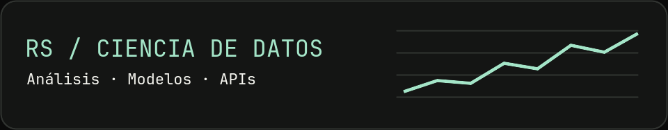

# Robinson Josuee Sanchez Mayta

**Estudiante de 5.º ciclo de Ingeniería en Ciencia de Datos e Inteligencia Artificial en SENATI** · Ate, Lima, Perú

Construyo proyectos que van desde la exploración de datos y el entrenamiento de modelos hasta su uso en tableros y APIs. Busco prácticas preprofesionales en ciencia de datos, machine learning, ingeniería de datos o backend.

[Portafolio](https://rsanchezmayta.github.io/) · [LinkedIn](https://linkedin.com/in/robinson-josuee-sanchez-mayta-03a229429) · [Correo](mailto:robinsonjsm281006@gmail.com)

## Proyectos destacados

### Denuncias policiales en Perú

Tablero para explorar **369 mil denuncias del SIDPOL–MININTER** con un mapa coroplético y una API REST. Usa **K-means** para agrupar registros y **SARIMA** para pronosticar tendencias.

`Python` · `Laravel` · `MySQL` · `Leaflet` 
[Ver repositorio de denuncias](https://github.com/rsanchezmayta/denuncias-policiales-peru)

### Lima Housing Analysis

Análisis de datos inmobiliarios de Lima que abarca desde la exploración y la ingeniería de variables hasta la evaluación de modelos de **XGBoost y Random Forest** y el despliegue en Streamlit.

`Python` · `pandas` · `XGBoost` · `Streamlit` 
[Ver repositorio de análisis inmobiliario](https://github.com/rsanchezmayta/lima-housing-analysis)

### Predicción de retrasos en entregas

Clasificador **Random Forest** integrado en una API REST con Flask y una interfaz web. El proyecto incluye **16 pruebas** y automatización con GitHub Actions.

`Python` · `scikit-learn` · `Flask` · `pytest` 
[Ver repositorio de predicción de retrasos](https://github.com/rsanchezmayta/prediccion-retrasos-entrega)

[Ver código de mi portafolio](https://github.com/rsanchezmayta/rsanchezmayta.github.io) · [Todos mis repositorios](https://github.com/rsanchezmayta?tab=repositories)

## Herramientas

- **Datos y modelos** · Python, SQL, pandas, NumPy, scikit-learn y XGBoost
- **APIs y bases de datos** · Flask, Laravel, MySQL y PostgreSQL
- **Pruebas y automatización** · pytest, Git y GitHub Actions

## Actualmente

- Reforzando Docker y MLOps con MLflow, versionado de modelos y pipelines.
- Practicando visualización con Plotly y Folium e inglés técnico con documentación y papers.
- Completé la formación *Getting Started with DevOps on AWS*.

<!--START_SECTION:activity-->
<!--END_SECTION:activity-->
